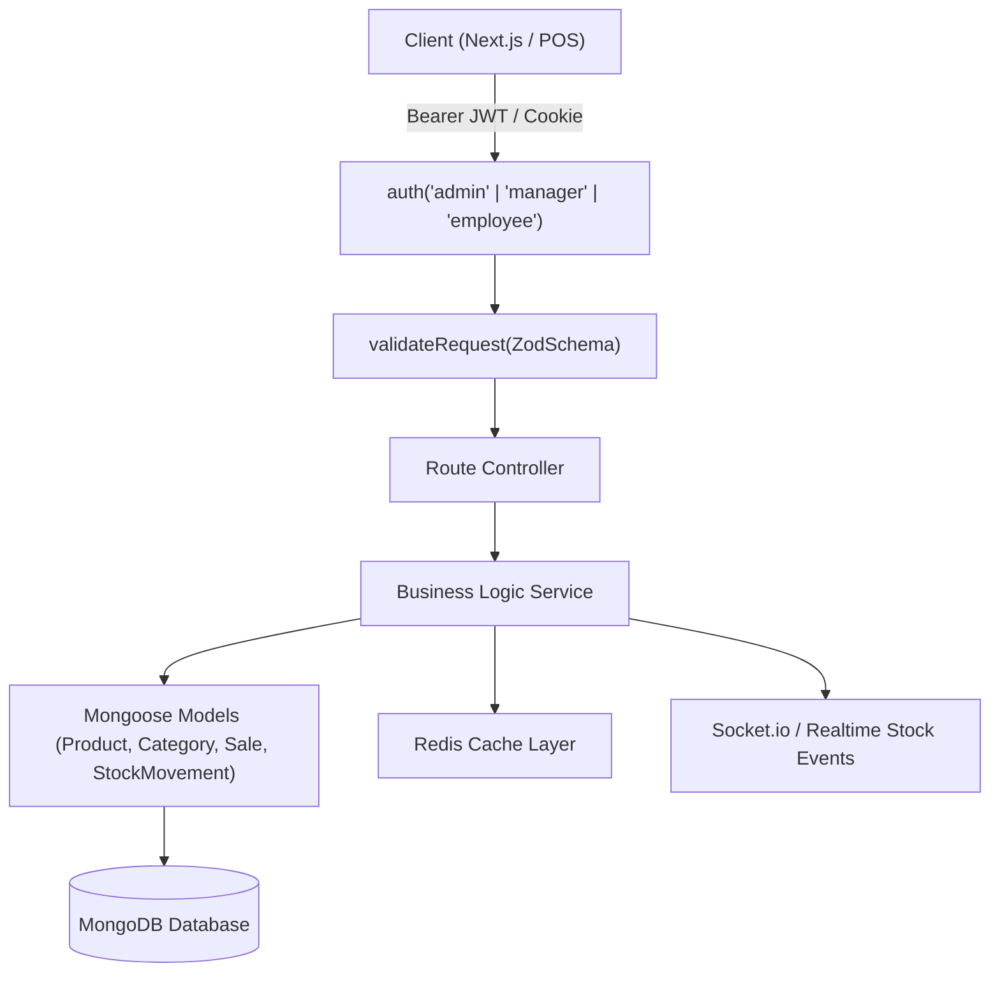
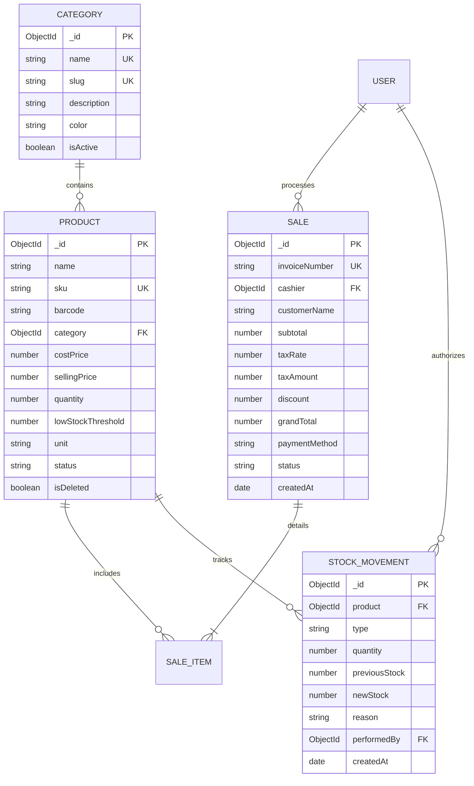

# StockWise — Smart Inventory Management System
## Server Architecture & API Flow Specification

---

## 1. System Architecture Overview

The StockWise Backend API is designed for reliability, strict data consistency, and high-performance querying for inventory management.

---

## 2. Domain Data Models & Relationships

---

## 3. Endpoints & API Route Directory

All routes are prefixed with `/api/v1`.

### 3.1 Authentication & User Management
- `POST /api/v1/auth/register` — Register new user account.
- `POST /api/v1/auth/login` — Sign in and issue Access + Refresh JWTs.
- `GET /api/v1/user/get-my-profile` — Fetch current user details & role.
- `GET /api/v1/user/get-all` — List all registered users (Admin only).

### 3.2 Category Management (`/api/v1/category`)
- `POST /create` — Create category (`admin`, `manager`).
- `GET /get-all` — List all categories with product counts (`common`).
- `GET /find/:id` — Get single category (`common`).
- `PATCH /update/:id` — Update category details (`admin`, `manager`).
- `DELETE /delete/:id` — Delete category (rejects if products still linked) (`admin`).

### 3.3 Product Catalog (`/api/v1/product`)
- `POST /create` — Add new product with initial stock log (`admin`, `manager`).
- `GET /get-all` — List products with search, category, status, pagination (`common`).
- `GET /find/:id` — Get detailed product info (`common`).
- `PATCH /update/:id` — Edit product details (`admin`, `manager`).
- `DELETE /delete/:id` — Soft-delete product (`admin`).

### 3.4 Stock Adjustments & Movements (`/api/v1/stock-movement`)
- `POST /adjust` — Record manual stock adjustment / restock (`admin`, `manager`).
- `GET /get-all` — List full audit ledger across all products (`admin`, `manager`).
- `GET /product/:productId` — Get movement history for a specific product (`common`).

### 3.5 Sales & POS Checkout (`/api/v1/sale`)
- `POST /checkout` — Process instant sale, atomic stock deduction, invoice generation (`common`).
- `GET /get-all` — List all sales records with date & cashier filter (`common`).
- `GET /find/:id` — Get invoice & itemized details (`common`).
- `GET /recent` — Fetch last 5 recent sales for dashboard (`common`).

### 3.6 Analytics, Dashboard & Alerts (`/api/v1/analytics`)
- `GET /dashboard-overview` — KPI metrics (Total products, stock value, revenue, low stock count, sales trends) (`common`).
- `GET /low-stock-alerts` — List items requiring urgent replenishment (`common`).

### 3.7 AI Stock Advisor (`/api/v1/ai-advisor`)
- `GET /forecast` — Compute daily velocity, run-out estimates, and AI recommendations (`admin`, `manager`).

### 3.8 Notification Center & Real-Time Alerts (`/api/v1/notification`)
- `GET /get-all` — Retrieve paginated notifications and system stock alerts (`common`).
- `PATCH /mark-as-read` — Mark an individual notification or all notifications as read (`common`).

---

## 4. Business Logic & Transaction Guarantees

1. **Automatic Status Computation**:
   Whenever a product's quantity is saved or updated:
   - If `quantity <= 0` $\rightarrow$ `status = "out_of_stock"`
   - If `quantity <= lowStockThreshold` $\rightarrow$ `status = "low_stock"`
   - Otherwise $\rightarrow$ `status = "in_stock"`

2. **Atomic POS Checkout**:
   - Each item in the checkout payload is checked against current DB inventory.
   - If any item has insufficient stock, the transaction is rejected with `400 Bad Request`.
   - On success:
     - Product quantity is decremented.
     - `StockMovement` of type `"SALE"` is generated for each item.
     - Unique invoice `#INV-YYYYMMDD-XXXX` is generated.
     - Real-time low-stock alerts are dispatched via Socket.io if an item drops below threshold.

3. **Audit Trail Integrity**:
   - Direct stock modifications are tracked with the user ID, previous balance, new balance, and reason note.

4. **Real-Time WebSocket Events**:
   - `low_stock_alert` — Dispatched automatically when an item's balance drops to or below its configured `lowStockThreshold` (payload: `productId`, `productName`, `sku`, `quantity`, `lowStockThreshold`, `status`, `timestamp`).
   - `sale_completed` — Emitted upon successful checkout to synchronize frontend views and live analytics counter.
